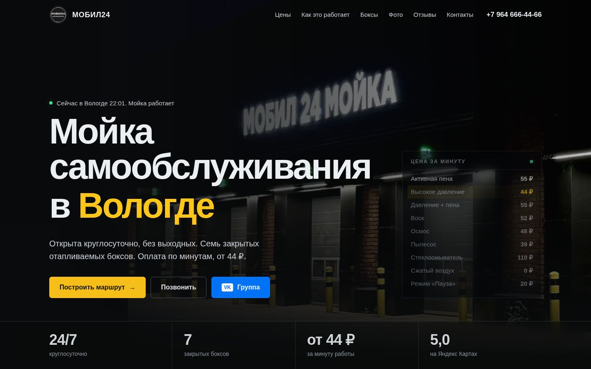

# МОБИЛ24: сайт мойки самообслуживания

Одностраничный адаптивный сайт для круглосуточной мойки самообслуживания **МОБИЛ24** (Вологда, Окружное шоссе, 9).
Чистые HTML, CSS и JavaScript: без сборки, фреймворков и зависимостей. Открывается двойным щелчком по `index.html`.



## Что на сайте
Мобильная версия сделана первой, десктоп дополняет её (mobile-first). На ПК колёсико мыши работает с плавной инерцией; на телефонах прокрутка родная. Подвал содержит небольшой логотип студии-разработчика со ссылкой на её сайт.

Главный экран с живым временем в Вологде, табло цен и кнопками «Маршрут», «Позвонить», «Группа ВК» · цены строками со шкалой и фото режима · демонстрация работы терминала (оплата, ручка режимов, счётчик) · два варианта боксов (7 боксов) со схемой дверей · мозаика фото с просмотром всех 14 · отзывы с рейтингом 5,0 · контакты с картой · нижняя панель «Позвонить / ВКонтакте / Маршрут» на телефонах · SEO-разметка (Schema.org AutoWash) · цели Яндекс.Метрики.

Больше скриншотов: [`docs/screenshots/`](docs/screenshots/).

## Быстрый старт
```bash
# вариант 1: просто откройте index.html в браузере
# вариант 2: локальный сервер
python3 -m http.server 8000      # затем http://localhost:8000
```

## Структура проекта
```
index.html                 разметка страницы, мета-теги, JSON-LD
site.webmanifest, favicon.ico, robots.txt, sitemap.xml
assets/
  css/styles.css           все стили (токены, компоненты, секции, адаптив)
  js/config.js             НАСТРОЙКИ: телефон, ссылки, Метрика, включение видео
  js/data.js               КОНТЕНТ: услуги и цены, отзывы, галерея, боксы
  js/main.js               поведение: рендер, лайтбокс, карусель, видео, цели
  img/                     оптимизированные фото (webp), логотип, иконки, og-image
  video/                   сюда кладут видео (сейчас пусто, см. ниже)
docs/                      документация и скриншоты
scripts/screenshots.py     скриншоты для документации (Playwright)
scripts/test-responsive.py проверка адаптива на 9 разрешениях (320–1920 px)
```

## Что менять чаще всего
| Задача | Где |
|---|---|
| Телефон, VK, Telegram, ссылка на карту | `assets/js/config.js` |
| Цены и описания режимов | `assets/js/data.js`, массив `SERVICES` |
| Отзывы | `assets/js/data.js`, массив `REVIEWS` |
| Фото в галерее | положить файл в `assets/img/`, добавить строку в `GALLERY` |
| Яндекс.Метрика | `config.js`, поле `metrikaId` |
| Видео | `config.js`, `videos`; файлы в `assets/video/` |

Подробности: [docs/CONTENT-GUIDE.md](docs/CONTENT-GUIDE.md).

## Публикация
Сайт статический, подходит любой хостинг (GitHub Pages, Netlify, Cloudflare Pages, обычный хостинг по FTP).
Перед запуском замените `https://YOUR-DOMAIN.ru` на реальный адрес в `index.html`, `robots.txt`, `sitemap.xml`.
Инструкции: [docs/DEPLOYMENT.md](docs/DEPLOYMENT.md). Чек-лист запуска: [docs/CHECKLIST.md](docs/CHECKLIST.md).

## Документация
- [Дизайн-система](docs/DESIGN-SYSTEM.md): цвета, шрифты, компоненты, анимации
- [Редактирование контента](docs/CONTENT-GUIDE.md)
- [Публикация](docs/DEPLOYMENT.md)
- [Промпты для видео](docs/VIDEO-PROMPTS.md): необязательный ролик для главного экрана
- [Чек-лист перед запуском](docs/CHECKLIST.md)
- [Проверка адаптива](docs/TESTING.md)
- [История изменений](CHANGELOG.md)

## Источники данных и ограничения
Цены, описания режимов, отзывы, рейтинг и характеристики боксов взяты из карточки на Яндекс Картах, сообщества ВКонтакте и материалов владельца. Фото предоставил заказчик.
Перед запуском владелец должен проверить актуальность цен. Шрифт Golos Text подключаются из Google Fonts; при их недоступности используются системные.
Совместимость: современные Chrome, Safari, Firefox, Edge (две последние версии), iOS Safari, Android Chrome.
